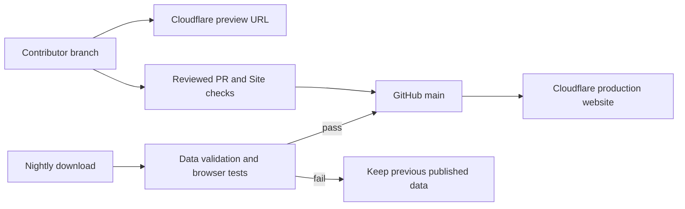

# Hosting and automatic updates

Recommended setup: **Cloudflare Pages Free + this GitHub repository**. The app remains static: damage calculations run in the visitor's browser. No rented server, database, paid build service, or site account system is needed.

## One-time setup

1. Create/sign into a [Cloudflare account](https://dash.cloudflare.com/sign-up).
2. Open **Workers & Pages → Create application → Pages → Connect to Git**. Authorize GitHub access to `arudich/pokelator-pro`, then select that repository.
3. Use these build settings:

   | Setting | Value |
   | --- | --- |
   | Production branch | `main` |
   | Framework preset | None |
   | Build command | `python3 scripts/build_site.py` |
   | Build output directory | `dist` |
   | Root directory | Leave blank |

4. Save and deploy. Cloudflare supplies an HTTPS address such as `https://YOUR-PROJECT.pages.dev`; the exact project name must be available. A custom domain can be added later, but is unnecessary to launch.
5. Under the Pages project's branch controls, enable preview deployments for all non-production branches. In GitHub, enable Actions if prompted. Open **Actions → Nightly data and engine refresh → Run workflow** once to verify the hosted automation.

No Cloudflare API token or custom deployment secret is needed for Git integration. GitHub's automatic token publishes validated nightly snapshots; the workflow requests `contents: write` only in that final job. If organization/repository policy denies this, allow the workflow write access in Actions settings. A branch rule that blocks bot pushes to main must grant the nightly bot permission, or updates will need a maintainer merge.

## Updating and sharing versions

- Push to `main`: Cloudflare updates the live site automatically.
- Push another branch: Cloudflare creates an isolated, shareable preview, with a branch alias and an immutable deployment URL. Main remains live.
- Open a PR from a branch in this repository: Cloudflare attaches its preview URL to the PR. Contributors can work on branches once invited as collaborators.
- **Forked PRs:** Cloudflare's native integration does not publish their previews. The contributor can connect their fork to their own free Pages project, or a maintainer can copy the reviewed changes to a branch in this repository. GitHub CI still checks forked PRs without write credentials.
- Merge approved, passing changes into main to release them. Use the GitHub branch/PR interface or normal Git commands. Prefer branches and passing Site checks over directly pushing unfinished edits to main.
- To undo a bad release, revert its commit and push; Cloudflare also offers production deployment rollbacks in its dashboard.



## What runs nightly

The schedule is **06:23 UTC**, approximately 1:23 a.m. New York standard time / 2:23 a.m. daylight time. GitHub may delay scheduled runs; it is not a precise-time service.

1. Download the current Champions roster and both formats' complete usage CSVs.
2. Find the newest published complete Singles/Doubles Champions regulation pair in Smogon's monthly archive. Monthly data remains monthly; checking nightly cannot create unavailable statistics. Source month and exact regulation identifiers remain in the data.
3. Download the latest stable published `@smogon/calc` and `@pkmn/dex` releases. Verify npm SHA-512 integrity, retain their version/hash information, and rebuild supplemental move effects using Pokémon Showdown’s Champions-specific move overrides (including accuracy, PP and secondary effects). Refresh ability/item descriptions and item sprite paths too.
4. Validate schemas, stat budgets, source coverage and bundle checksums. Run the browser, damage, optimizer and packaging regression suite.
5. Only after success, commit the verified `data/` and `vendor/` snapshot to main. Cloudflare deploys that push. The publishing job refuses to overwrite main if a contributor changed it during validation.

`data/refresh-status.json` records the last successful source check, roster generation time, regulation/month and exact engine/package hashes. The daily check record creates repository activity even when the source contents are unchanged, helping avoid GitHub's 60-day inactivity shutdown for scheduled public workflows. If updates fail continuously, GitHub can eventually disable the schedule; enable failure notifications for this workflow and inspect the Actions page.

On any download, validation or regression failure, no update is pushed, so the last deployed snapshot stays live. The failed step and job summary identify what needs attention. Run the workflow manually after fixing it. Original source downloads are temporary, not committed.

### Balance patches, including December

Usage data and mechanics are separate. A usage refresh alone cannot update move powers or ability behavior. The engine and move metadata are refreshed separately so published upstream patch support can be adopted automatically after checks pass.

This cannot guarantee same-day game-patch support: upstream packages may lag the game, and new mechanics may require adapter code. Tests also deliberately reject incompatible changes instead of silently publishing incorrect damage. Check the engine/version and workflow after December's patch lands. Do not change expected damage values merely to make an unexplained failed test pass.

## Cost and limits

- Cloudflare Pages Free currently permits **500 builds/month**. A nightly deployment consumes roughly 30–31, leaving room for normal development and previews.
- Standard GitHub Actions runners are free for public repositories. The workflows pin standard Ubuntu 24.04 runners for Playwright compatibility, not paid larger runners.
- The `pages.dev` hostname and HTTPS are included. A personally owned domain is optional and has its own registration cost.
- There is no server-side damage computation or database bill. Pokémon/item art still comes from the existing external Champions data source.

## Moving saved teams to the live site

Localhost, the production hostname, custom domains and each preview hostname have separate browser storage. Before changing addresses, open **Other Teams → Export all** on the old address, then **Import** on the new address. Exports include remembered per-team builds for removed Pokémon as well as current team members. Keep the JSON file as a backup. Color preferences are also browser-local. Merely publishing the code does not transfer localStorage to another domain or another device.

## Local commands

```sh
# Build the public-only dist folder. Python is the only build requirement.
python3 scripts/build_site.py
python3 -m http.server 8000 --directory dist --bind 127.0.0.1

# Refresh candidate data locally (requires Node and network access).
python3 scripts/refresh_site_data.py
python3 scripts/validate_site_data.py
python3 -m unittest discover -s tests -v
```

The deployed bundle includes only runtime HTML/CSS/JS, data, engine files and their licenses; it excludes Git metadata, scripts, tests, docs, virtual environments and credentials. Build-specific asset versions and revalidation headers keep browser/worker data consistent across releases.

## Primary references

- [Cloudflare Git setup](https://developers.cloudflare.com/pages/get-started/git-integration/)
- [Pages branch and preview behavior](https://developers.cloudflare.com/pages/configuration/git-integration/github-integration/)
- [Free-plan build limits](https://developers.cloudflare.com/pages/platform/limits/)
- [GitHub scheduled workflow behavior](https://docs.github.com/en/actions/reference/workflows-and-actions/events-that-trigger-workflows#schedule)
- [Public-repository runner pricing](https://docs.github.com/en/actions/how-tos/write-workflows/choose-where-workflows-run/choose-the-runner-for-a-job)
